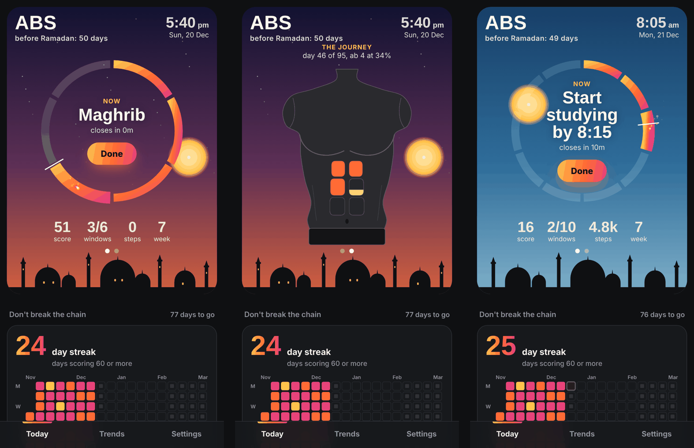
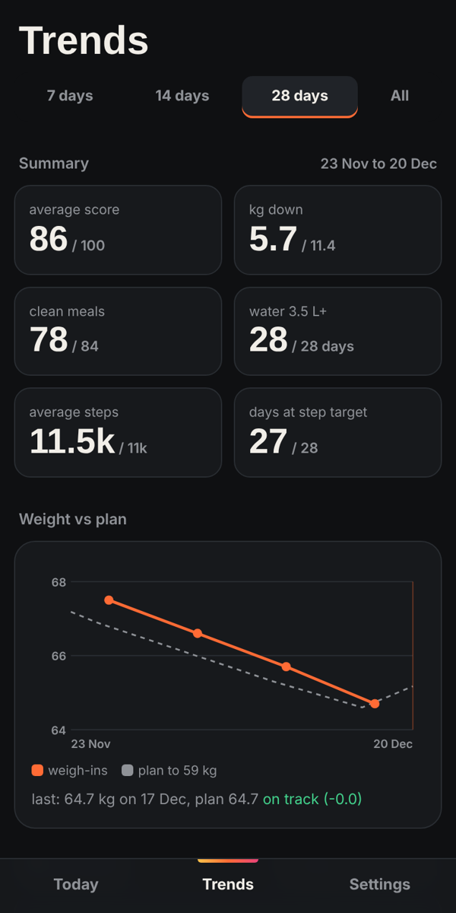

<div align="center">


# getfit

**Commit to the routine. Ship the abs.**

For busy professional Muslims who want to transform their body in 3 months and be in shape before Eid.<br>
A 70 KB, zero-dependency PWA that builds the whole day around the five prayers, a full-time job and the gym, and turns it into a streak.

<br>


<br>



<sub>The day ring at dusk &nbsp;·&nbsp; the journey torso &nbsp;·&nbsp; an 8:05 am study window</sub>

</div>

<br>

## The idea

You have a 9-to-6 job, five prayers to make at the masjid, and a body you want to change before Eid. There's no room for a plan that ignores any of them.

**getfit** is built around the day a working Muslim actually has. Salah anchors the schedule; the gym, work, study and meals fit between the prayers. Every part of the day becomes a small commit with a deadline. The app scores it and shows the result two ways: how consistent you were today, and how far you are into the 3-month journey.

A cut fails on the days you don't notice slipping. This makes every slip visible the same day.

```
Nov 5 ─────────────── 95-day cut ─────────────── Feb 7 │ Ramadan ── Mar 7 │ Eid
70.4 kg                                                │           59 kg  │ in shape
```

<br>

## What's on the screen

<table>
<tr>
<td width="50%" valign="top">

### A sky that keeps time
The header follows **Pakistan time**, whatever the phone's zone says. Dawn at Fajr, blue at midday, gold in the afternoon, dusk at Maghrib, stars at night. The sun and moon cross over a masjid skyline whose windows light up after dark.

### The day ring
One arc per window. The live window burns and drifts embers; done windows glow orange; missed ones go red. A hand marks exactly where you are in the day.

</td>
<td width="50%" valign="top">

### The journey
Swipe the sky to see a torso that slims as the cut goes on: love handles shrink, the belly flattens, and **six abs fill one by one**, top pair first. Full at a 75 average over 95 days. Every morning it replays yesterday's points pouring in.

### Don't break the chain
A contribution graph of the whole cut. Every day scoring 60+ extends the streak.

</td>
</tr>
</table>

<br>

## The rules

| Window | Weight | Rule |
|---|:-:|---|
| Fajr | ×3 | Masjid only. Locks 1 h after close. Sunday allows qaza at half |
| Leave for gym | ×2 | Mon–Fri |
| Start studying by 8:15 | ×2 | Mon–Fri |
| Start work by 10:15 | ×1 | Mon–Fri |
| Zuhr · Asr · Maghrib | ×3 | Masjid full, elsewhere half. Lock after 1 h |
| Juma | ×3 | Friday. Masjid only, on time only |
| Isha | ×3 | Masjid only, on time only |
| Stop work by 7:45 | ×1 | Mon–Fri |
| Phone down, into bed | ×2 | Sun–Thu nights |

Plus daily checks: three clean meals, snack on plan, water in two tiers, the planned session (legs, active recovery and abs are **no-skip**), sleep, and steps.

> **Thursday check-in.** Weight, eight tape measurements and progress photos by **9:00 am**. Miss it and the whole day scores zero.

```
day score = points earned ÷ points possible × 100
late ×0.6 · elsewhere ×0.5 · qaza ×0.5 · snack over plan −1 · water not logged −1
```

<br>

## Trends



- **Weight vs plan**, Thursday weigh-ins against the line to 59 kg
- **Measurements**, latest value and change against each of the last four Thursdays, green toward the goal, red away from it, plus the full dated log
- **Day score**, daily bars against the 60 line
- **Salah**, masjid on time, late, elsewhere, qaza, missed, per prayer
- **Training by week**, with no-skip misses in red
- **Steps and sleep** against target

<br clear="right">

## Built with

Nothing. One `index.html` with inline CSS, inline SVG and vanilla JS, a 10-line service worker, and a manifest. Data lives in the phone's `localStorage`; nothing is sent anywhere.

| | |
|---|---|
| Sky, skyline, ring, torso | Hand-built SVG, recomputed per render |
| Embers and bursts | One `<canvas>`, paused when the tab is hidden |
| Time | `Intl.DateTimeFormat` pinned to `Asia/Karachi` |
| Offline | Service worker, network first, cache fallback |
| Motion | Respects `prefers-reduced-motion` |

<br>

## Install

1. Open **https://sulemanawais.github.io/getfit/** in Chrome on Android
2. Menu → **Add to Home screen** → Install
3. Settings → **Copy backup** every Thursday after the weigh-in

<br>

<div align="center">
<sub>Three months, five prayers a day, one goal: in shape by Eid. Fork it and make it yours.</sub>
</div>
